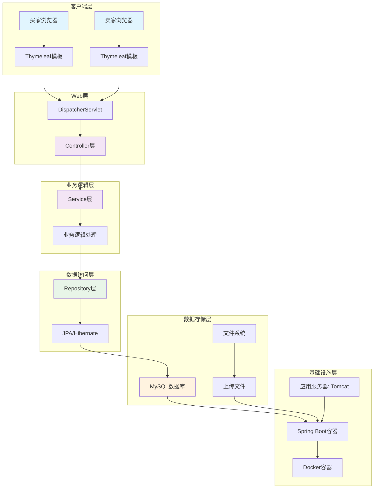
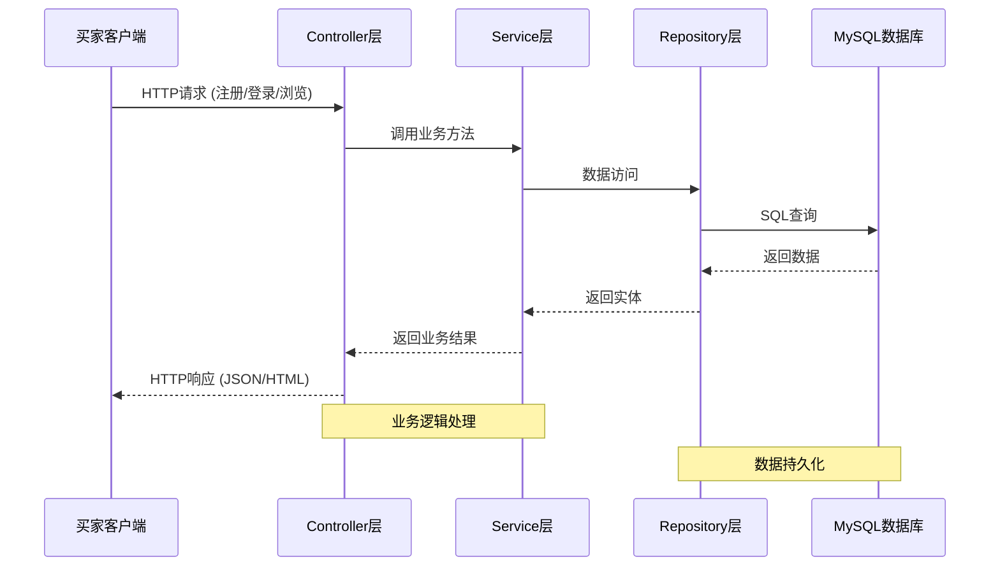
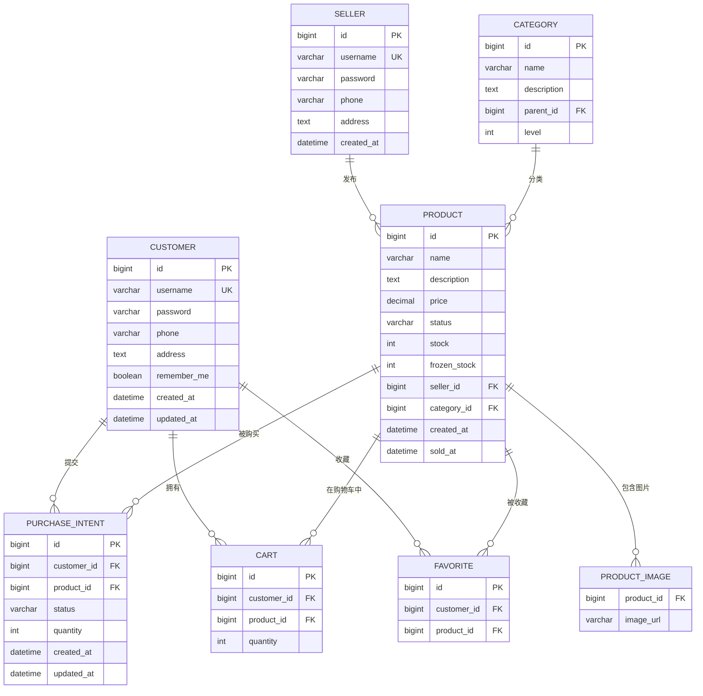
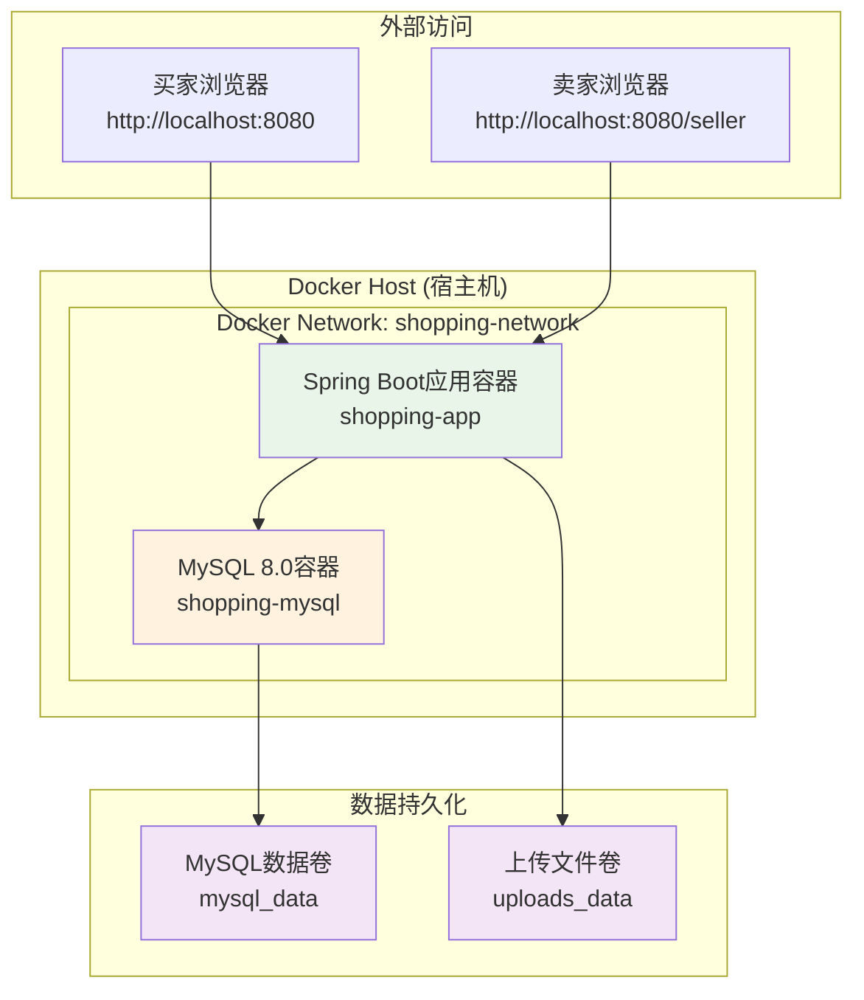

# 在线购物平台系统架构图

## 1. 系统概述

在线购物平台是一个基于Spring Boot的完整电商系统，采用MVC分层架构，支持买家、卖家、商品管理、购买意向、购物车、收藏等核心功能。

## 2. 技术架构图

### 2.1 整体架构图（Mermaid语法）



### 2.2 分层架构图

```
┌─────────────────────────────────────────────────────────────┐
│                   客户端层 (Client Layer)                    │
├─────────────────────────────────────────────────────────────┤
│  • 买家前端 (index.html + script.js + style.css)            │
│  • 卖家后台 (seller.html + seller-script.js)                │
│  • Thymeleaf模板引擎渲染                                    │
└─────────────────────────────────────────────────────────────┘
                               │
                               ▼
┌─────────────────────────────────────────────────────────────┐
│                   Web层/控制器层 (Web Layer)                 │
├─────────────────────────────────────────────────────────────┤
│  • DispatcherServlet (请求分发)                             │
│  • Controller类 (7个控制器)                                 │
│    - CustomerController: 买家注册/登录                      │
│    - SellerController: 卖家登录/商品管理                    │
│    - ProductController: 商品CRUD操作                        │
│    - PurchaseIntentController: 购买意向管理                 │
│    - CartController: 购物车管理                             │
│    - FavoriteController: 收藏管理                           │
│    - HomeController: 首页展示                               │
│  • 请求验证与异常处理                                       │
└─────────────────────────────────────────────────────────────┘
                               │
                               ▼
┌─────────────────────────────────────────────────────────────┐
│                业务逻辑层 (Business Logic Layer)             │
├─────────────────────────────────────────────────────────────┤
│  • Service类 (6个服务)                                      │
│    - CustomerService: 买家业务逻辑                          │
│    - SellerService: 卖家业务逻辑                            │
│    - ProductService: 商品业务逻辑                           │
│    - PurchaseIntentService: 购买意向业务逻辑                │
│    - CartService: 购物车业务逻辑                            │
│    - FavoriteService: 收藏业务逻辑                          │
│  • 业务规则验证                                             │
│  • 事务管理 (@Transactional)                                │
│  • 数据转换 (DTO ↔ Entity)                                  │
└─────────────────────────────────────────────────────────────┘
                               │
                               ▼
┌─────────────────────────────────────────────────────────────┐
│                数据访问层 (Data Access Layer)                │
├─────────────────────────────────────────────────────────────┤
│  • Repository接口 (7个Repository)                           │
│    - CustomerRepository                                     │
│    - SellerRepository                                       │
│    - ProductRepository                                      │
│    - PurchaseIntentRepository                               │
│    - CartRepository                                         │
│    - FavoriteRepository                                     │
│    - CategoryRepository                                     │
│  • JPA/Hibernate ORM框架                                    │
│  • 数据库查询优化                                           │
│  • 缓存策略 (一级/二级缓存)                                 │
└─────────────────────────────────────────────────────────────┘
                               │
                               ▼
┌─────────────────────────────────────────────────────────────┐
│                数据存储层 (Data Storage Layer)               │
├─────────────────────────────────────────────────────────────┤
│  • MySQL 8.0数据库                                          │
│  • 数据库表 (8个核心表)                                     │
│    - customers: 买家表                                      │
│    - sellers: 卖家表                                        │
│    - products: 商品表                                       │
│    - categories: 分类表                                     │
│    - purchase_intents: 购买意向表                           │
│    - carts: 购物车表                                        │
│    - favorites: 收藏表                                      │
│    - product_images: 商品图片表                             │
│  • 文件系统 (上传文件存储)                                  │
└─────────────────────────────────────────────────────────────┘
```

## 3. 组件关系图

### 3.1 核心组件交互图



### 3.2 实体关系图



## 4. 数据流图

### 4.1 买家购物流程

```
┌─────────┐     ┌─────────────┐     ┌─────────────┐     ┌─────────────┐
│  买家   │────▶│  浏览商品   │────▶│  加入购物车 │────▶│  提交订单   │
└─────────┘     └─────────────┘     └─────────────┘     └─────────────┘
     │               │                     │                     │
     ▼               ▼                     ▼                     ▼
┌─────────┐     ┌─────────────┐     ┌─────────────┐     ┌─────────────┐
│  登录   │     │  Product    │     │   Cart      │     │ Purchase    │
│  注册   │     │ Controller  │     │ Controller  │     │ Intent      │
└─────────┘     └─────────────┘     └─────────────┘     └─────────────┘
```

### 4.2 卖家商品管理流程

```
┌─────────┐     ┌─────────────┐     ┌─────────────┐     ┌─────────────┐
│  卖家   │────▶│  登录系统   │────▶│  发布商品   │────▶│  管理订单   │
└─────────┘     └─────────────┘     └─────────────┘     └─────────────┘
     │               │                     │                     │
     ▼               ▼                     ▼                     ▼
┌─────────┐     ┌─────────────┐     ┌─────────────┐     ┌─────────────┐
│ Seller  │     │  Product    │     │  图片上传   │     │ 订单状态    │
│Service  │     │  Service    │     │  文件系统   │     │  更新       │
└─────────┘     └─────────────┘     └─────────────┘     └─────────────┘
```

## 5. 部署架构图

### 5.1 Docker容器化部署



### 5.2 端口映射配置

```
宿主机 (Host Machine)          Docker容器 (Container)
────────────────────────────────────────────────────
localhost:8080      ────────▶ shopping-app:8080
localhost:3307      ────────▶ shopping-mysql:3306
```

## 6. 系统运行原理

### 6.1 请求处理流程

1. **HTTP请求接收**
   - 客户端发送HTTP请求到Spring Boot应用
   - DispatcherServlet接收并解析请求
   - 根据URL映射找到对应的Controller

2. **业务逻辑处理**
   - Controller接收请求参数，进行初步验证
   - 调用对应的Service层处理业务逻辑
   - Service层执行业务规则验证和数据处理
   - 调用Repository层进行数据持久化操作

3. **数据持久化**
   - Repository层通过JPA/Hibernate生成SQL语句
   - 执行数据库操作（增删改查）
   - 返回实体对象给Service层

4. **响应返回**
   - Service层处理业务结果，返回给Controller
   - Controller封装响应数据（JSON/HTML）
   - 通过Thymeleaf模板引擎渲染HTML页面
   - 返回HTTP响应给客户端

### 6.2 核心功能模块交互

1. **用户认证模块**
   ```
   客户端 → CustomerController/SellerController → CustomerService/SellerService → Repository → MySQL
   ```

2. **商品管理模块**
   ```
   客户端 → ProductController → ProductService → ProductRepository → MySQL + 文件系统
   ```

3. **购物流程模块**
   ```
   浏览商品 → 加入购物车 → 提交购买意向 → 卖家确认 → 完成交易
   ```

## 7. 可生成的架构图形式

基于当前项目，可以生成以下形式的架构图：

### 7.1 文本形式架构图
- **ASCII艺术图**：使用字符绘制层次结构
- **Mermaid语法图**：可在支持Mermaid的Markdown编辑器中渲染
- **PlantUML图**：使用PlantUML语法生成UML图

### 7.2 图像文件格式
1. **PNG/JPG格式**：
   - 使用绘图工具（如draw.io、Lucidchart）创建
   - 导出为高清图像文件

2. **SVG矢量图**：
   - 可缩放矢量图形，适合文档嵌入
   - 使用Inkscape或在线工具创建

3. **PDF文档**：
   - 包含完整架构图的PDF报告
   - 适合打印和正式文档

### 7.3 交互式架构图
1. **Web版架构图**：
   - 使用D3.js或ECharts创建交互式图表
   - 支持点击查看组件详情

2. **架构文档网站**：
   - 使用VuePress或Docsify创建架构文档站点
   - 包含可交互的架构图

### 7.4 具体建议
1. **立即可用的**：
   - 本文档中的Mermaid图表（可直接复制到支持Mermaid的编辑器中）
   - ASCII架构图（可直接在终端或文档中显示）

2. **需要工具生成的**：
   - 使用draw.io创建专业架构图
   - 使用PlantUML生成UML序列图和类图

3. **推荐方案**：
   - **开发文档**：使用Mermaid语法，便于版本控制
   - **演示汇报**：使用draw.io创建精美图表
   - **技术设计**：使用PlantUML生成标准UML图

## 8. 架构特点总结

1. **分层清晰**：严格遵循MVC分层架构，职责分离明确
2. **模块化设计**：功能模块划分清晰，便于维护和扩展
3. **容器化部署**：支持Docker容器化，便于环境一致性
4. **前后端分离**：Thymeleaf模板引擎实现前后端适度分离
5. **数据持久化**：JPA/Hibernate提供对象关系映射，简化数据库操作
6. **RESTful设计**：API设计遵循RESTful原则，接口规范统一
7. **安全性考虑**：包含输入验证、异常处理等安全机制

## 9. 后续架构演进建议

1. **微服务化**：将单体应用拆分为微服务（用户服务、商品服务、订单服务等）
2. **API网关**：引入API网关统一管理API接口
3. **消息队列**：引入消息队列处理异步任务（如订单通知）
4. **缓存优化**：引入Redis缓存提升系统性能
5. **监控体系**：建立完整的应用监控和日志收集体系
6. **CI/CD流水线**：建立自动化构建、测试和部署流程

---

**文档说明**：
- 本文档使用Mermaid语法绘制图表，可在支持Mermaid的Markdown编辑器（如VS Code、Typora、GitHub）中直接渲染
- 所有架构描述基于当前shopping-system项目的实际代码结构
- 部署架构基于实际的docker-compose.yml配置
- 实体关系基于实际的JPA实体类定义
